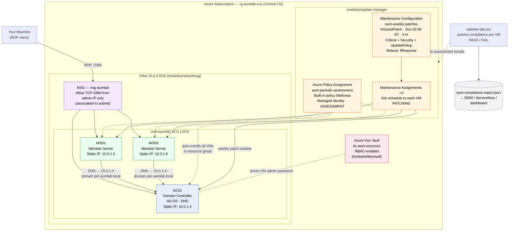
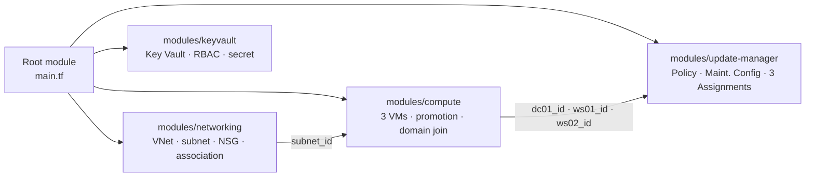

## Lab Series
 
This lab is fully standalone. It deploys its own infrastructure into its own resource group and has no dependency on Lab 1 or Lab 2 — run it before, after, or independently of the others.
# Azure Update Manager Lab
 
**Patch Management & Compliance Reporting · Terraform (Modular) + Azure Update Manager + PowerShell**
 
Builds a complete patch management pipeline from zero: modular Terraform infrastructure, policy-based enrollment, a scheduled maintenance window, on-demand patch assessment, emergency patching, and a compliance validation script that exports machine-readable JSON reports — with before/after evidence from a real run.
 
📹 **Walkthrough video:** _add your Loom / LinkedIn link here_
 
| | |
|---|---|
| **VMs** | `DC01` (Domain Controller) · `WS01` (Member Server) · `WS02` (Member Server) |
| **OS** | Windows Server 2022 Datacenter (Gen2) on all three VMs |
| **Domain** | `aumlab.local` |
| **As deployed** | `rg-aumlab-cus` · Central US · `Standard_E2bds_v5` (see [Lessons Learned](#lessons-learned--real-issues-hit) for why) |
| **Deploy time** | 15–30 minutes — DC01 domain promotion is the longest step |
| **Cost** | ~$0.75/hr total at E2bds_v5 (~$18/day) — **always run `terraform destroy` when finished** |
| **Tooling** | Terraform (modular), Azure Update Manager, Azure Policy, Azure Key Vault, PowerShell |
| **Part of** | 3-lab series — see [Lab Series](#lab-series) below |
 
This repo is self-contained. Every Terraform and PowerShell file needed is included.
 
---
 
## Table of Contents
 
- [Lab Series](#lab-series)
- [What This Lab Demonstrates](#what-this-lab-demonstrates)
- [Results](#results)
- [Skills Exercised](#skills-exercised)
- [Architecture](#architecture)
- [Repository Structure](#repository-structure)
- [Prerequisites](#prerequisites)
- [Deployment Guide](#deployment-guide)
- [Assess, Validate, Patch, Re-validate](#assess-validate-patch-re-validate)
- [Teardown](#teardown)
- [Lessons Learned — Real Issues Hit](#lessons-learned--real-issues-hit)
- [Lab-Only Security Shortcuts](#lab-only-security-shortcuts)
- [Troubleshooting](#troubleshooting)
---
 

 
| Lab | Deploys | Relationship |
|---|---|---|
| **Lab 1 — NTFS File Server** | `DC01`, `FS01`, `CLIENT01`, VNet, NSG, Key Vault in `RG-FileServerLab` | Standalone — builds all infrastructure from scratch |
| **Lab 2 — Azure RBAC** | 3 role assignments on `FS01` only, no new VMs | Depends on Lab 1 — reads Lab 1 resources via data sources, reuses Lab 1's storage account |
| **AUM Lab — Azure Update Manager** *(this repo)* | `DC01`, `WS01`, `WS02`, VNet, Key Vault in its own RG | Standalone — fully independent from Labs 1 and 2 |
 
**Remote state:** if you've done Lab 1 or Lab 2, reuse the same `RG-TerraformState` storage account with the new state key (`aum-lab.tfstate`). All three labs share one container without affecting each other.
 
---
 
## What This Lab Demonstrates
 
**The problem:** unpatched systems are one of the most common root causes of security incidents. The challenge at scale isn't patching one server — it's knowing which machines are missing which patches, enforcing a consistent schedule, and producing documentation that proves compliance to auditors.
 
On-premises, this was WSUS — a server you had to run, maintain, and keep updated yourself. **Azure Update Manager** is the cloud-native replacement: agentless for Azure VMs, integrated with Azure Policy for automatic enrollment, maintaining a compliance record per machine, and supporting both scheduled and on-demand patching.
 
**The real-world scenario:** a CVE is disclosed with a CVSS score of 9.8, and security asks which servers are missing the fix. The ops engineer triggers an on-demand assessment across all VMs and pulls a compliance report. Affected machines are identified, an emergency patch run targets Critical/Security updates, and a new compliance report confirms everything is compliant. The whole workflow is automated, documented, and auditable.
 
### The three concepts that matter
 
| Concept | Terraform resource | Answers the question |
|---|---|---|
| **Policy** (enrollment) | `azurerm_resource_group_policy_assignment` | *Which VMs get assessed?* |
| **Maintenance Configuration** (schedule) | `azurerm_maintenance_configuration` | *When and what do we patch?* |
| **Maintenance Assignment** (linkage) | `azurerm_maintenance_assignment_virtual_machine` ×3 | *Who gets patched on that schedule?* |
 
> **Assessment and patching are separate operations.** A machine enrolled in assessment but not linked to a maintenance window shows compliance data but never receives automated patches. A VM must be covered by **both** policy and an assignment to be assessed *and* automatically patched.
 
---
 
## Results
 
Actual run, all three servers:
 
| Step | Action | Outcome |
|---|---|---|
| 1 | On-demand assessment (`assessPatches`) | Each VM: **1 Critical/Security** + 2 other updates missing |
| 2 | `validate-lab.ps1` | `[FAIL]` × 3 → **FAILURES DETECTED** → [`aum-compliance-report-BEFORE.json`](aum-compliance-report-BEFORE.json) |
| 3 | Emergency patch (`az vm install-patches`, Critical + Security + UpdateRollup, reboot if required) | **Succeeded** on all 3 — 2 installed, 0 failed |
| 4 | Re-assess + `validate-lab.ps1` | `[PASS]` × 3 → **ALL PASS** → [`aum-compliance-report-AFTER.json`](aum-compliance-report-AFTER.json) |
 
```
=== Azure Update Manager Compliance Validation ===
[PASS] DC01 -- Critical/Security missing: 0 | Other: 2 | Status: Succeeded | Reboot pending: False
[PASS] WS01 -- Critical/Security missing: 0 | Other: 2 | Status: Succeeded | Reboot pending: False
[PASS] WS02 -- Critical/Security missing: 0 | Other: 2 | Status: Succeeded | Reboot pending: False
 
Overall: ALL PASS
```
 
The 2 remaining "Other" updates fall outside the targeted classifications (e.g., definition/optional updates) and don't count against compliance.
 
---
 
## Skills Exercised
 
| Skill | Real-world relevance |
|---|---|
| Modular Terraform | Each module has one responsibility, is independently testable, and is reusable across environments — how real engineering teams organize code (by domain, not resource type) |
| Azure Policy for automatic enrollment | Define the rule once and every matching VM — including future ones — is enrolled automatically; how compliance is enforced at scale |
| Maintenance windows | A contract with the business: patches applied in this window, with this reboot behavior, targeting these classifications |
| Assessment vs. patching | Understanding the distinction prevents both under-patching and unexpected reboots |
| On-demand assessment + emergency patching | When a critical CVE drops, you need exposure *right now* and a fix that doesn't wait for Sunday |
| Compliance validation with structured export | Query state → print human-readable output → export JSON: the foundation for feeding SIEMs, ticketing systems, and executive dashboards |
| Cloud troubleshooting | Capacity restrictions, quota analysis, state recovery — see [Lessons Learned](#lessons-learned--real-issues-hit) |
 
---
 
## Architecture
 

 
**How it works:** Azure Policy auto-enrolls every VM in the resource group into periodic patch assessment. The Maintenance Configuration defines the weekly schedule and patch classifications. Three maintenance assignments link that schedule to each individual VM. `validate-lab.ps1` queries compliance state per VM and exports a JSON report. `DC01` is the domain controller; `WS01` and `WS02` simulate production workloads.
 
### Terraform Module Layout
 

 
### Why Each Component Exists
 
| Component | Purpose |
|---|---|
| **Modular Terraform (4 modules)** | Each module owns one concern — change VM size in `modules/compute` without touching networking or update-manager |
| `modules/networking` | VNet, subnet, NSG (RDP from your IP only), and the explicit subnet–NSG association — without it, the NSG exists but applies to nothing |
| `modules/keyvault` | Stores the admin password. `enable_rbac_authorization = true` is critical: without it, role assignments on the vault are silently ignored and every secret operation returns 403. A 60s `time_sleep` waits for RBAC propagation before the secret is written |
| `modules/compute` | Three VMs plus domain promotion/join extensions. **`patch_mode = "AutomaticByPlatform"` + `bypass_platform_safety_checks_on_user_schedule_enabled = true`** are required for customer-managed schedules — without them the maintenance window never patches. `WS01`/`WS02` use `depends_on` to wait for `DC01`'s promotion |
| `modules/update-manager` | Policy (enrollment) + Maintenance Configuration (schedule) + Assignments (linkage) |
| Azure Policy `59efceea` | Built-in "Configure periodic checking for missing system updates on Azure VMs." Uses the **Modify** effect, so the assignment needs a **system-assigned managed identity** and a **Virtual Machine Contributor** role for remediation. Assessment only — does not apply patches |
| `azurerm_maintenance_configuration` | `scope = InGuestPatch`, `in_guest_user_patch_mode = User`, classifications limited to Critical, Security, and UpdateRollup, reboot only `IfRequired` |
| `azurerm_maintenance_assignment_virtual_machine` ×3 | Connects `DC01`, `WS01`, `WS02` to the weekly patch window |
| Static private IPs (`.4`, `.5`, `.6`) | Member servers point DNS at `10.0.1.4`. All three are static so a member server's NIC can't grab `.4` before DC01's NIC is created |
| `validate-lab.ps1` JSON export | Console output is for humans; JSON is for SIEMs, ServiceNow integrations, and Blob Storage audit history. A real compliance program needs both |
 
---
 
## Repository Structure
 
```
azure-update-manager-lab/
├── backend.tf                         # Remote state configuration
├── versions.tf                        # Providers: azurerm ~> 3.100, random ~> 3.6, time ~> 0.11
├── variables.tf                       # All input variables (incl. patch_window_start)
├── main.tf                            # Root module wiring all 4 child modules
├── outputs.tf                         # VM public IPs and Key Vault name
├── terraform.tfvars.example           # Safe template — commit this
├── .gitignore                         # Excludes tfvars, tfstate, tfplan, .terraform/
├── aum-compliance-report-BEFORE.json  # Evidence: 3x FAIL before patching
├── aum-compliance-report-AFTER.json   # Evidence: 3x PASS after patching
├── modules/
│   ├── networking/main.tf             # VNet, subnet, NSG, NSG-subnet association
│   ├── keyvault/main.tf               # Key Vault (RBAC model) + admin password secret
│   ├── compute/main.tf                # 3 VMs, domain promotion, domain join
│   └── update-manager/main.tf         # Policy + Maintenance Config + 3 Assignments
└── scripts/
    └── validate-lab.ps1               # Compliance validation + JSON report export
```
 
---
 
## Prerequisites
 
```powershell
terraform -version     # >= 1.5.0
az version             # Any recent Azure CLI
 
# Az PowerShell (only the two modules validate-lab.ps1 needs)
Install-Module Az.Accounts, Az.Compute -Scope CurrentUser -Force
Set-ExecutionPolicy -Scope CurrentUser RemoteSigned   # allow signed modules/local scripts
 
# Register required resource providers — both must show "Registered" before apply
az provider register --namespace Microsoft.Maintenance
az provider register --namespace Microsoft.GuestConfiguration
az provider show --namespace Microsoft.Maintenance --query registrationState -o tsv
az provider show --namespace Microsoft.GuestConfiguration --query registrationState -o tsv
```
 
You need **Owner** (or User Access Administrator + Contributor) on the subscription — the lab creates role assignments. Check VM quota and SKU availability in your region first (see [Lessons Learned](#lessons-learned--real-issues-hit)).
 
---
 
## Deployment Guide
 
1. **Remote state** — skip if you already have a state storage account from another lab:
```powershell
az group create --name RG-TerraformState --location centralus
az storage account create --name <UNIQUE_NAME> --resource-group RG-TerraformState --sku Standard_LRS
az storage container create --name tfstate --account-name <UNIQUE_NAME>
```
   Then set `storage_account_name` in `backend.tf`.
 
2. **Configure variables:**
```powershell
Copy-Item terraform.tfvars.example terraform.tfvars
# Set: allowed_rdp_ip (your IPv4 /32), location, resource_group_name,
#      patch_window_start (must be a FUTURE date, "YYYY-MM-DD hh:mm")
 
# Password goes in an environment variable — never in a file. Single quotes.
$env:TF_VAR_admin_password = 'YourStrongPassword123!'
```
   VM size is set in `modules/compute/main.tf` (`local.vm_size`).
 
3. **Deploy:**
```powershell
terraform init
terraform plan "-out=aum-lab.tfplan"   # quotes required in Windows PowerShell
# Expect: Plan: 28 to add, 0 to change, 0 to destroy
terraform apply aum-lab.tfplan          # 15–30 minutes
```
 
---
 
## Assess, Validate, Patch, Re-validate
 
```powershell
$rg    = "rg-aumlab-cus"
$subId = az account show --query id -o tsv
Connect-AzAccount -TenantId <your-tenant-id>   # for validate-lab.ps1
```
 
**1. On-demand assessment** (same as **Assess Now** in the portal; ~5–10 min):
```powershell
foreach ($vm in "DC01","WS01","WS02") {
    az rest --method POST `
      --url "https://management.azure.com/subscriptions/$subId/resourceGroups/$rg/providers/Microsoft.Compute/virtualMachines/$vm/assessPatches?api-version=2022-03-01"
}
```
 
**2. Validate** — expect `FAIL` on fresh VMs (patches outstanding = the pipeline is working):
```powershell
.\scripts\validate-lab.ps1 -ResourceGroup $rg -SubscriptionId $subId
Copy-Item .\aum-compliance-report.json .\aum-compliance-report-BEFORE.json
```
 
**3. Emergency patch** — a maintenance window can't be fired early, so use a one-time install:
```powershell
foreach ($vm in "DC01","WS01","WS02") {
    az vm install-patches -g $rg -n $vm --maximum-duration PT2H --reboot-setting IfRequired `
      --classifications-to-include-win Critical Security UpdateRollup --no-wait
}
# Poll until all show Succeeded (UpdateRollups on Standard HDD can take 20-30 min)
foreach ($vm in "DC01","WS01","WS02") {
    az vm get-instance-view -g $rg -n $vm --query "instanceView.patchStatus.lastPatchInstallationSummary.{VM:'$vm',Status:status,Installed:installedPatchCount,Failed:failedPatchCount}" -o table
}
```
 
**4. Re-assess (step 1), then re-validate:**
```powershell
.\scripts\validate-lab.ps1 -ResourceGroup $rg -SubscriptionId $subId
Copy-Item .\aum-compliance-report.json .\aum-compliance-report-AFTER.json
```
 
### Portal Verification Checklist
 
- [ ] **Azure Update Manager → Machines** — all 3 VMs show as assessed
- [ ] **Maintenance Configurations → `aum-weekly-patches` → Machines** — all 3 VMs linked
- [ ] **Policy → Assignments** — periodic assessment policy assigned on the resource group
- [ ] **Azure Update Manager → History** — the one-time install run shows Succeeded
---
 
## Teardown
 
> **Always destroy when finished.** At E2bds_v5 pricing, ~$0.75/hr ≈ $18/day.
 
```powershell
terraform destroy -auto-approve
az group exists --name rg-aumlab-cus   # expect: false
```
 
---
 
## Lessons Learned — Real Issues Hit
 
| Problem | Cause | Fix |
|---|---|---|
| `SkuNotAvailable` for `Standard_B2s` (East US), then `Standard_D2s_v3` (Central US) | Regional capacity restrictions on the subscription | Queried `az vm list-skus` (what's offered) **and** `az vm list-usage` (what quota allows) — only `Standard_E2bds_v5` satisfied both. Switched to the Gen2 image (`2022-datacenter-g2`) for compatibility |
| "Provider produced inconsistent result" / resources reported missing seconds after creation | Resource group deleted in one region and recreated with the **same name** in another within minutes — stale ARM reads | Deleted the RG, cleared state (`terraform state rm`), redeployed under a new RG name |
| `terraform plan -out=...` → "Too many command line arguments" | Windows PowerShell splits `-out=file.tfplan` at the dot | Quote it: `terraform plan "-out=aum-lab.tfplan"` |
| Az module → "running scripts is disabled" | Default `Restricted` execution policy | `Set-ExecutionPolicy -Scope CurrentUser RemoteSigned` |
| `Connect-AzAccount` token failure | MFA on a personal-account tenant | `Connect-AzAccount -TenantId <tenant-id>` |
| `assessPatches` → `OperationNotAllowed` | Patch install still running even though `Installed` count was already > 0 | Poll `lastPatchInstallationSummary` until `Succeeded`, then re-assess |
 
---
 
## Lab-Only Security Shortcuts
 
Hardened compared to the original SOP — domain promotion/join scripts are passed as `-EncodedCommand` through **`protected_settings`** (encrypted, not visible in the portal or plan output), and the DSRM password is no longer hardcoded. Remaining shortcuts that would **not** be acceptable in production:
 
- The DSRM password reuses the VM admin password.
- The password is passed into the VM extensions from Terraform rather than retrieved from Key Vault at runtime by a managed identity.
- VMs have public IPs with RDP exposed (restricted to one /32) — production would use Azure Bastion or a VPN.
---
 
## Troubleshooting
 
| Problem | Cause | Solution |
|---|---|---|
| Provider registration error during apply | `Microsoft.Maintenance` or `Microsoft.GuestConfiguration` not registered | `az provider show` for each; wait for `Registered`, then re-apply |
| 403 on Key Vault secret during apply | `enable_rbac_authorization` missing, or RBAC propagation delay | Confirm the flag; the 60s `time_sleep` handles propagation. Re-run `terraform apply` |
| `SkuNotAvailable` (409) on VM create | No capacity for that size in the region | Check `az vm list-skus -l <region>` and `az vm list-usage -l <region>`; pick a size that's offered and within quota |
| DC01 extension fails or times out | AD promotion failure or extension timeout | Re-run `terraform apply`. Check portal → DC01 → Extensions |
| WS01/WS02 domain join fails | DC01 still rebooting after promotion | The join script waits 2 min, then retries for ~20 min. Re-run `terraform apply` if it still fails |
| `validate-lab.ps1` shows `Status:` blank | Assessment not yet complete | Wait 5–10 minutes and re-run |
| `validate-lab.ps1` shows Critical missing > 0 | Expected on a fresh VM | Correct behavior — run the emergency patch step, re-assess, re-validate |
| `start_date_time` error during plan | `patch_window_start` is in the past | Set a future date in `terraform.tfvars` |
 
---
 
**Stack:** Terraform (modular) · Azure Update Manager · Azure Policy · Azure Maintenance Configuration · Azure Key Vault · Active Directory Domain Services · PowerShell
 
