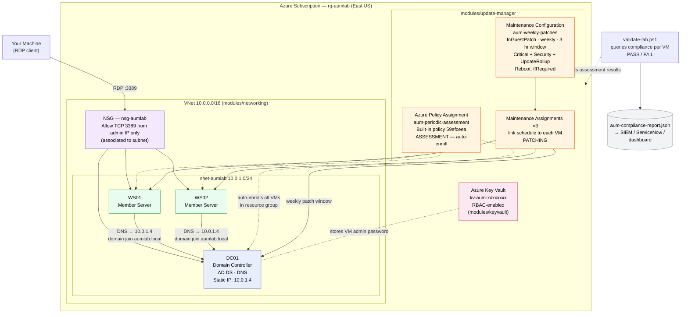
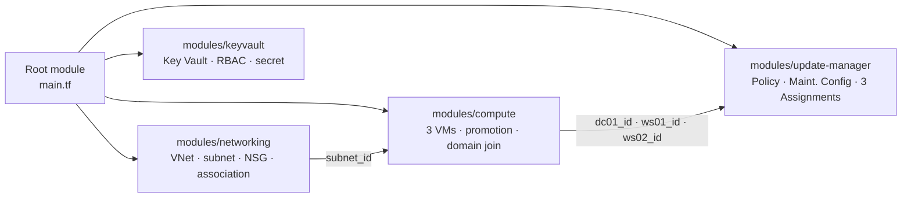

# Azure Update Manager Lab

**Patch Management & Compliance Reporting · Terraform (Modular) + Azure Update Manager + PowerShell**

Builds a complete patch management pipeline from zero: modular Terraform infrastructure, policy-based enrollment, a scheduled maintenance window, on-demand patch assessment, and a compliance validation script that exports a machine-readable JSON report.

| | |
|---|---|
| **VMs** | `DC01` (Domain Controller) · `WS01` (Member Server) · `WS02` (Member Server) |
| **OS** | Windows Server 2022 on all three VMs |
| **Domain** | `aumlab.local` |
| **Resource group** | `rg-aumlab` (Region: East US) |
| **Deploy time** | 15–20 minutes — DC01 domain promotion is the longest step |
| **Cost** | ~$0.17/hr total (~$4/day) — **always run `terraform destroy` when finished** |
| **Tooling** | Terraform (modular), Azure Update Manager, Azure Policy, Azure Key Vault, PowerShell 7 |
| **Part of** | 3-lab series — see [Lab Series](#lab-series) below |

This repo is self-contained. Every Terraform and PowerShell file needed is included — no external downloads beyond Terraform, Azure CLI, and PowerShell 7.

---

## Table of Contents

- [Lab Series](#lab-series)
- [What This Lab Demonstrates](#what-this-lab-demonstrates)
- [Skills Exercised](#skills-exercised)
- [Architecture](#architecture)
- [Repository Structure](#repository-structure)
- [Prerequisites](#prerequisites)
- [Deployment Guide](#deployment-guide)
- [Trigger Assessment and Validate](#trigger-assessment-and-validate)
- [Teardown](#teardown)
- [Troubleshooting](#troubleshooting)

---

## Lab Series

This lab is fully standalone. It deploys its own infrastructure into its own resource group and has no dependency on Lab 1 or Lab 2 — run it before, after, or independently of the others.

| Lab | Deploys | Relationship |
|---|---|---|
| **Lab 1 — NTFS File Server** | `DC01`, `FS01`, `CLIENT01`, VNet, NSG, Key Vault in `RG-FileServerLab` | Standalone — builds all infrastructure from scratch |
| **Lab 2 — Azure RBAC** | 3 role assignments on `FS01` only, no new VMs | Depends on Lab 1 — reads Lab 1 resources via data sources, reuses Lab 1's storage account |
| **AUM Lab — Azure Update Manager** *(this repo)* | `DC01`, `WS01`, `WS02`, VNet, Key Vault in `rg-aumlab` | Standalone — fully independent from Labs 1 and 2 |

**Remote state:** if you've done Lab 1 or Lab 2, reuse the same `RG-TerraformState` storage account and just use the new state key (`aum-lab.tfstate`). All three labs share one container without affecting each other. If this is your first lab, the setup commands in [Deployment Guide](#deployment-guide) create everything from scratch.

---

## What This Lab Demonstrates

**The problem:** unpatched systems are one of the most common root causes of security incidents. The challenge at scale isn't patching one server — it's knowing which machines are missing which patches, enforcing a consistent schedule, and producing documentation that proves compliance to auditors.

On-premises, this was WSUS — a server you had to run, maintain, and keep updated yourself. **Azure Update Manager** is the cloud-native replacement: agentless for Azure VMs, integrated with Azure Policy for automatic enrollment, maintaining a compliance record per machine, and supporting both scheduled patching and manual approval workflows.

**The real-world scenario:** a CVE is disclosed with a CVSS score of 9.8, and security asks which servers are missing the fix. The ops engineer triggers an on-demand assessment across all VMs and pulls a compliance report within 15 minutes. Affected machines are identified, an emergency maintenance window targeting Critical updates is created, patching runs, and a new compliance report confirms everything is compliant. The whole workflow is automated, documented, and auditable.

### The three concepts that matter

| Concept | Terraform resource | Answers the question |
|---|---|---|
| **Policy** (enrollment) | `azurerm_resource_group_policy_assignment` | *Which VMs get assessed?* |
| **Maintenance Configuration** (schedule) | `azurerm_maintenance_configuration` | *When and what do we patch?* |
| **Maintenance Assignment** (linkage) | `azurerm_maintenance_assignment_virtual_machine` ×3 | *Who gets patched on that schedule?* |

> **Assessment and patching are separate operations.** A machine enrolled in assessment but not linked to a maintenance window shows compliance data but never receives automated patches. A VM must be covered by **both** policy and an assignment to be assessed *and* automatically patched.

---

## Skills Exercised

| Skill | Real-world relevance |
|---|---|
| Modular Terraform | Each module has one responsibility, is independently testable, and is reusable across environments — how real engineering teams organize code (by domain, not resource type) |
| Azure Policy for automatic enrollment | Define the rule once and every matching VM — including future ones — is enrolled automatically; how compliance is enforced at scale |
| Maintenance windows | A contract with the business: patches applied in this window, with this reboot behavior, targeting these classifications. Without one, patches never get applied or hit at unpredictable times |
| Assessment vs. patching | Understanding the distinction prevents both under-patching and unexpected reboots |
| On-demand assessment | When a critical CVE drops, you need exposure *right now*, not at the next scheduled scan |
| Compliance validation with structured export | Query state → print human-readable output → export JSON: the foundation for feeding SIEMs, ticketing systems, and executive dashboards |

---

## Architecture



**How it works:** Azure Policy auto-enrolls every VM in the resource group into periodic patch assessment. The Maintenance Configuration defines the weekly schedule and patch classifications. Three maintenance assignments link that schedule to each individual VM. `validate-lab.ps1` queries compliance state per VM and exports a JSON report. `DC01` is the domain controller; `WS01` and `WS02` simulate production workloads.

### Terraform Module Layout



### Why Each Component Exists

| Component | Purpose |
|---|---|
| **Modular Terraform (4 modules)** | Each module owns one concern — change VM size in `modules/compute` without touching networking or update-manager |
| `modules/networking` | VNet, subnet, NSG (RDP from your IP only), and the explicit subnet–NSG association — without it, the NSG exists but applies to nothing |
| `modules/keyvault` | Stores the admin password. `enable_rbac_authorization = true` is critical: without it, role assignments on the vault are silently ignored and every secret operation returns 403 |
| `modules/compute` | Three VMs plus domain promotion/join extensions. `WS01`/`WS02` use `depends_on` to wait for `DC01`'s promotion — preventing the most common failure where workstations try to join before the domain exists |
| `modules/update-manager` | Policy (enrollment) + Maintenance Configuration (schedule) + Assignments (linkage) |
| Azure Policy `59efceea` | Built-in "Configure periodic checking for missing system updates on Azure VMs." Any VM added to `rg-aumlab` is auto-enrolled; assessments run roughly every 24 hours. **Assessment only — does not apply patches** |
| `azurerm_maintenance_configuration` | `scope = InGuestPatch` (patches inside the guest OS), `in_guest_user_patch_mode = User` (this Terraform config owns the schedule), classifications limited to Critical, Security, and UpdateRollup, reboot only `IfRequired` |
| `azurerm_maintenance_assignment_virtual_machine` ×3 | Connects `DC01`, `WS01`, `WS02` to the weekly patch window |
| Static IP on `DC01` (`10.0.1.4`) | Member servers point DNS here during domain join; a changed IP would break `aumlab.local` resolution |
| `validate-lab.ps1` JSON export | Console output is for humans; JSON is for SIEMs, ServiceNow integrations, and Blob Storage audit history. A real compliance program needs both |

---

## Repository Structure

```
azure-update-manager-lab/
├── backend.tf                         # Remote state configuration
├── versions.tf                        # Provider version requirements (azurerm ~> 3.100, random ~> 3.6)
├── variables.tf                       # All input variables
├── main.tf                            # Root module wiring all 4 child modules
├── outputs.tf                         # VM public IPs and Key Vault name
├── terraform.tfvars.example           # Safe template — commit this
├── terraform.tfvars                   # Real values — DO NOT commit
├── .gitignore
├── modules/
│   ├── networking/main.tf             # VNet, subnet, NSG, NSG-subnet association
│   ├── keyvault/main.tf               # Key Vault (RBAC model) + admin password secret
│   ├── compute/main.tf                # 3 VMs, domain promotion, domain join
│   └── update-manager/main.tf         # Policy + Maintenance Config + 3 Assignments
└── scripts/
    └── validate-lab.ps1               # Compliance validation + JSON report export
```

---

## Prerequisites

```powershell
terraform -version     # >= 1.5.0
az version             # Any recent Azure CLI
pwsh --version         # PowerShell 7+
Install-Module Az -Scope CurrentUser -Force   # Az module, used by validate-lab.ps1

# Confirm correct subscription
az account show

# Register required resource providers — both must show "Registered" before apply
az provider register --namespace Microsoft.Maintenance
az provider register --namespace Microsoft.GuestConfiguration
az provider show --namespace Microsoft.Maintenance --query registrationState -o tsv
az provider show --namespace Microsoft.GuestConfiguration --query registrationState -o tsv
```

`Microsoft.Maintenance` is required for `azurerm_maintenance_configuration`; `Microsoft.GuestConfiguration` is required for in-guest patching.

---

## Deployment Guide

> Full file contents and inline rationale for every file live in [`docs/DEPLOYMENT.md`](docs/DEPLOYMENT.md). Summary below.

1. **Create the project structure:**
   ```powershell
   New-Item -ItemType Directory -Path "$HOME\azure-update-manager-lab"
   cd "$HOME\azure-update-manager-lab"
   foreach ($d in "modules/networking","modules/keyvault","modules/compute","modules/update-manager","scripts") {
       New-Item -ItemType Directory -Path $d
   }
   ```
2. **Add the root files:** `backend.tf`, `versions.tf`, `variables.tf`, `main.tf`, `outputs.tf`, `terraform.tfvars.example`, `.gitignore`.
3. **Add the four module files:** `modules/networking/main.tf`, `modules/keyvault/main.tf`, `modules/compute/main.tf`, `modules/update-manager/main.tf`. Folder names must match the `source` paths in the root `main.tf`.
4. **Add the validation script:** `scripts/validate-lab.ps1`.
5. **Remote state** — skip if you already have a state storage account from another lab; otherwise:
   ```bash
   az group create --name RG-TerraformState --location eastus
   az storage account create --name <UNIQUE_NAME> --resource-group RG-TerraformState --sku Standard_LRS
   az storage container create --name tfstate --account-name <UNIQUE_NAME>
   ```
   Then set `storage_account_name` in `backend.tf`. The state key `aum-lab.tfstate` is unique to this lab.
6. **Configure variables:**
   ```powershell
   Copy-Item terraform.tfvars.example terraform.tfvars
   # Set allowed_rdp_ip to your public IP in CIDR format (e.g., 1.2.3.4/32)

   # Password goes in an environment variable — never in a file
   $env:TF_VAR_admin_password = "YourStrongPassword123!"
   ```
7. **Update the maintenance window start date.** In `modules/update-manager/main.tf`, set `start_date_time` to a **future** date. If it's in the past, `terraform plan` fails.
8. **Deploy:**
   ```bash
   az login && az account show
   terraform init
   terraform plan -out=aum-lab.tfplan
   # Expect: 3 VMs, VNet + NSG + subnet + association, 1 Key Vault,
   #         1 Maintenance Configuration, 3 Maintenance Assignments, 1 Policy Assignment
   terraform apply aum-lab.tfplan    # 15–20 minutes
   ```

---

## Trigger Assessment and Validate

Azure Policy runs assessments on its own schedule, but triggering one manually surfaces compliance data right now — the same operation as clicking **Assess Now** in the portal.

```powershell
$subId = az account show --query id -o tsv

# Each assessment takes 5–10 minutes per VM
foreach ($vm in @("DC01","WS01","WS02")) {
    az rest --method POST `
        --url "https://management.azure.com/subscriptions/$subId/resourceGroups/rg-aumlab/providers/Microsoft.Compute/virtualMachines/$vm/assessPatches?api-version=2022-03-01"
    Write-Host "Assessment triggered: $vm"
}

# Wait 5–10 minutes, then validate
pwsh ./scripts/validate-lab.ps1 -ResourceGroup "rg-aumlab" -SubscriptionId $subId
```

`validate-lab.ps1` queries each VM's patch assessment, prints `[PASS]`/`[FAIL]` per machine, and exports `aum-compliance-report.json`. A **PASS** means the assessment succeeded *and* no Critical or Security patches are missing.

> **A FAIL with "Critical missing > 0" on a brand-new VM is expected.** The machine has patches outstanding, which proves the assessment pipeline is working. Apply patches via the maintenance window, then re-run validation to confirm compliance.

### Portal Verification Checklist

- [ ] **Azure Update Manager → Machines** — all 3 VMs show as *Assessed*
- [ ] **Maintenance Configurations → `aum-weekly-patches`** — all 3 VMs are linked
- [ ] **Policy → Assignments** — periodic assessment policy shows *Applied* on `rg-aumlab`

---

## Teardown

> **Always destroy when finished.** ~$0.17/hr ≈ $4/day ≈ $28/week if left running.

```bash
terraform destroy -auto-approve

# Verify everything is removed — expect: ResourceGroupNotFound
az group show --name rg-aumlab 2>&1
```

---

## Lab-Only Security Shortcuts

This is a learning lab. The following would **not** be acceptable in production:

- The DC01 DSRM (Safe Mode) password is hardcoded in `modules/compute/main.tf`.
- The admin password is interpolated directly into the domain-join extension command line.

In production, source both from Key Vault at runtime and avoid passing secrets through extension command lines.

---

## Troubleshooting

| Problem | Cause | Solution |
|---|---|---|
| Provider registration error during apply | `Microsoft.Maintenance` or `Microsoft.GuestConfiguration` not registered | Run `az provider show` for each; wait until both show `Registered`, then re-apply |
| 403 on Key Vault secret during apply | `enable_rbac_authorization` missing, or RBAC propagation delay | Confirm the flag is set in the keyvault module; re-run `terraform apply` — it resumes from the failed resource |
| DC01 extension fails or times out | AD promotion failure or Azure extension timeout | Re-run `terraform apply` (completed resources are skipped). Check Azure portal → DC01 → Extensions for details |
| WS01/WS02 domain join fails — DNS not resolving | DC01 took longer than 3 minutes to finish promotion | Re-run `terraform apply`; the join script waits for `aumlab.local` to resolve before `Add-Computer` |
| `validate-lab.ps1` shows `Status: null` | Assessment triggered but not yet complete | Wait 5–10 minutes and re-run |
| `validate-lab.ps1` shows Critical missing > 0 | Expected on a fresh VM — patches outstanding | Correct behavior. Run the maintenance window to patch, then re-validate |
| `start_date_time` error during plan | Date in `update-manager/main.tf` is in the past | Update to any future date and re-run plan |
| `terraform apply` changes nothing after a failed run | Resources partially created | Re-run `terraform apply` — Terraform reads current state and creates only what's missing |

---

**Stack:** Terraform (modular) · Azure Update Manager · Azure Policy · Azure Maintenance Configuration · Azure Key Vault · Active Directory Domain Services · PowerShell 7
